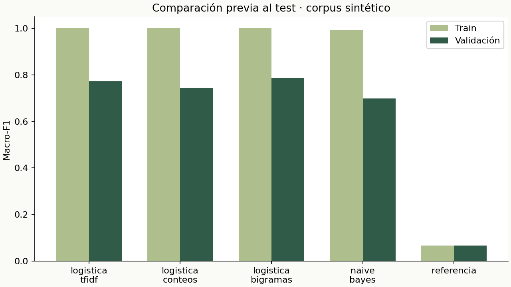
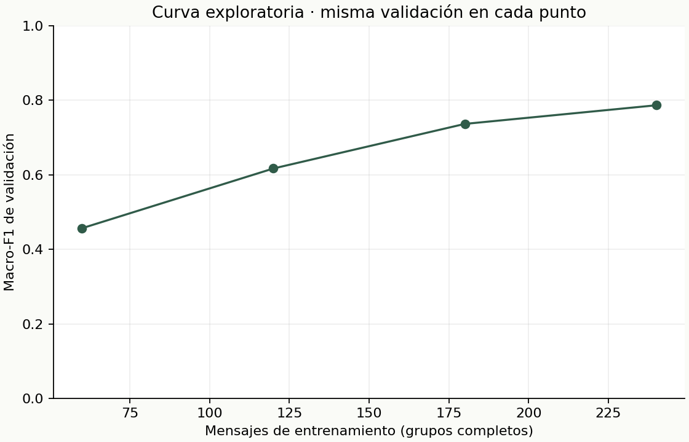
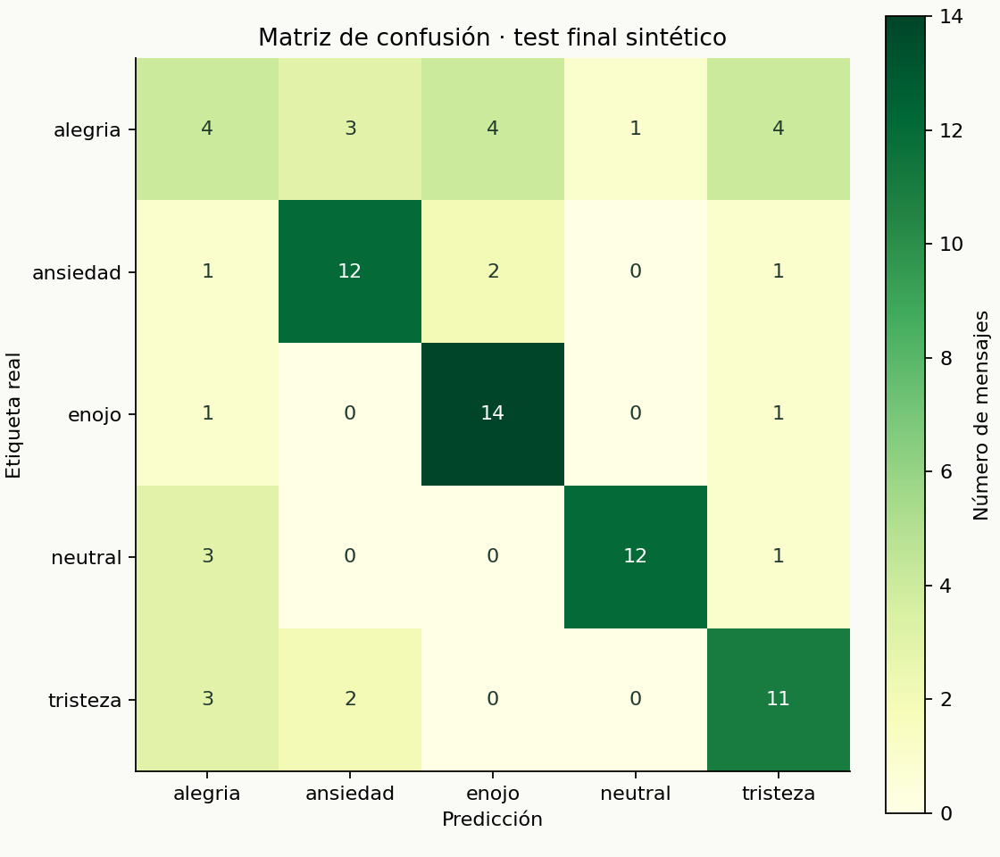

# Ánimo · Informe de resultados

Este documento lo genera `entrenamiento/p06_informe.py` a partir de archivos ejecutados y congelados. Fecha de evaluación (UTC): 2026-11-11T06:31:09.725664+00:00. No contiene cifras estimadas a mano. Las cifras redondeadas se presentan con tres decimales; los JSON conservan precisión completa.

## 1. Pregunta y alcance

¿Puede un clasificador sencillo distinguir cinco señales emocionales en mensajes breves en español, superando una referencia constante? Se implementó un chatbot académico local con respuestas redactadas, explicación de aportes de palabras, abstención y reglas de precaución independientes. La tarea es clasificar **texto**, no conocer el ánimo real ni identificar trastornos. «Ansiedad» es una etiqueta de preocupación textual.

## 2. Datos y validez

Corpus de **400 mensajes**, **200 escenarios**, dos paráfrasis por escenario. **El 100% es sintético y fue redactado con asistencia de IA para este proyecto**; no hay conversaciones reales, consentimiento de participantes ni etiquetas de especialistas. Etiquetas asignadas por intención del texto, sin doble anotación ni acuerdo entre anotadores. Ningún modelo preentrenado forma parte del sistema entregado. La asistencia de IA en la autoría del corpus y código se declara, y no equivale a entrenamiento con datos humanos.

| Partición | alegria | ansiedad | enojo | neutral | tristeza | Total |
| --- | --- | --- | --- | --- | --- | --- |
| train | 48 | 48 | 48 | 48 | 48 | 240 |
| validacion | 16 | 16 | 16 | 16 | 16 | 80 |
| test | 16 | 16 | 16 | 16 | 16 | 80 |

Semilla: 2026. La división se hace por escenario y clase. Se rechazan duplicados normalizados antes de dividir y se congelan hashes de los archivos. Los grupos resuelven la fuga de las paráfrasis declaradas; no prueban independencia semántica completa entre distintos escenarios. El mismo proceso de autoría produce todas las particiones: se comparten estilo y vocabulario, por lo que los resultados pueden ser optimistas. El autor conoce el corpus; no es un test externo ciego.

## 3. Representación y selección

Se conservan negaciones. Se normalizan mayúsculas, tildes y signos, con tokenización de palabras. TF-IDF es una ampliación práctica de la bolsa de palabras mencionada en clase. El vocabulario y el IDF se aprenden **solo en train**, dentro de Pipeline. No hay embeddings, descargas en ejecución ni APIs externas. El modelo servido se mantiene entrenado solo con train: no se reajusta después de la selección.

| Candidato | F1 train | F1 validación | Accuracy validación | Variables | Ajuste (s) |
| --- | --- | --- | --- | --- | --- |
| logistica_tfidf | 1.000 | 0.773 | 0.775 | 587 | 0.0226 |
| logistica_conteos | 1.000 | 0.745 | 0.750 | 587 | 0.0113 |
| logistica_bigramas | 1.000 | 0.787 | 0.787 | 1651 | 0.0171 |
| naive_bayes | 0.992 | 0.698 | 0.700 | 587 | 0.0027 |
| referencia | 0.067 | 0.067 | 0.200 | 587 | 0.0023 |

Ganador: **logistica_bigramas**, por macro-F1 de validación sin redondear. Brecha F1 train-validación: **0.213**. Comparar conteos y TF-IDF observa el efecto de ponderar términos; comparar unigramas y bigramas observa el efecto de incorporar parejas de palabras. Son experimentos con una sola partición, no pruebas estadísticas concluyentes de superioridad. Los tiempos corresponden al equipo de ejecución, no son un benchmark general.

## 4. Tamaño de entrenamiento

| Fracción de train | Mensajes | Grupos | F1 validación |
| --- | --- | --- | --- |
| 0.25 | 60 | 30 | 0.457 |
| 0.5 | 120 | 60 | 0.617 |
| 0.75 | 180 | 90 | 0.737 |
| 1.0 | 240 | 120 | 0.787 |

Se usan subconjuntos anidados por grupo y balanceados, con la misma validación. Es un análisis exploratorio; no se vuelve a elegir el modelo por esta curva. No demuestra una ley de escalamiento ni sustituye validación cruzada repetida.

## 5. Abstención

| Umbral | Cobertura validación | Accuracy aceptados |
| --- | --- | --- |
| 0.3 | 0.725 | 0.845 |
| 0.4 | 0.588 | 0.957 |
| 0.5 | 0.412 | 0.939 |
| 0.6 | 0.175 | 1.000 |
| 0.7 | 0.037 | 1.000 |

Umbral elegido: **0.3**. Regla: Mayor cobertura entre umbrales con accuracy selectiva >= .80 y cobertura >= .50. Además, se exige margen >= 0.10 y al menos una característica conocida. Son heurísticas de producto, no calibración probabilística. Palabras conocidas en un mensaje ajeno al dominio aún pueden inducir respuestas equivocadas. No existe un detector universal de fuera de dominio.

## 6. Test final, utilizado una sola vez

El modelo, selección y código se congelaron antes de la reserva exclusiva del test. Se ejecutó una sola inferencia por lote sobre **80 mensajes**, guardando scores y predicciones. `test_reservado.json` registra la apertura. Repetir el comando lee el resultado existente. Los gráficos y el bootstrap reutilizan predicciones guardadas; no hay nueva selección ni ajuste tras el test.

- **Accuracy total: 0.662**.
- **Macro-F1 total: 0.653**.
- Intervalo exploratorio percentil 95% de macro-F1 por escenario: **[0.543, 0.727]**, con **1000** remuestreos. Considera la dependencia de las dos paráfrasis de cada grupo. No incorpora incertidumbre de la selección del modelo ni sesgo sintético.
- Con abstención: **cobertura 0.750**, **60 aceptados de 80** y **accuracy entre aceptados 0.733**. Esta accuracy no debe confundirse con la del test completo.

| Clase | Precision | Recall | F1 | Soporte |
| --- | --- | --- | --- | --- |
| alegria | 0.333 | 0.250 | 0.286 | 16 |
| ansiedad | 0.706 | 0.750 | 0.727 | 16 |
| enojo | 0.700 | 0.875 | 0.778 | 16 |
| neutral | 0.923 | 0.750 | 0.828 | 16 |
| tristeza | 0.611 | 0.688 | 0.647 | 16 |

La debilidad más marcada es **alegria**: recall **0.250**, con **4 aciertos de 16**. La cifra global oculta esta diferencia. Además, **16 errores pasaron la abstención**; pedir contexto no garantiza que las etiquetas mostradas sean correctas. La meta selectiva de validación no se debe anunciar como rendimiento garantizado en test.

Macro-F1 promedia las cinco F1 con igual peso. Accuracy cuenta aciertos/total. Precision por clase = TP/(TP+FP); recall = TP/(TP+FN); F1 es la media armónica. Una accuracy alta no basta para comprobar que todas las clases funcionen bien.

| Real / predicha | alegria | ansiedad | enojo | neutral | tristeza |
| --- | --- | --- | --- | --- | --- |
| alegria | 4 | 3 | 4 | 1 | 4 |
| ansiedad | 1 | 12 | 2 | 0 | 1 |
| enojo | 1 | 0 | 14 | 0 | 1 |
| neutral | 3 | 0 | 0 | 12 | 1 |
| tristeza | 3 | 2 | 0 | 0 | 11 |

## 7. Errores observados, sin ocultarlos

**27 errores** en el test completo. Se muestran todos, incluso los casos que el sistema rechaza por incertidumbre. `aceptada=True` significa que el chatbot habría mostrado la etiqueta errónea. Este análisis es posterior y no se utilizó para cambiar datos, parámetros ni modelo.

| Texto sintético | Real | Predicha | Aceptada |
| --- | --- | --- | --- |
| Me siento agradecida por el apoyo que recibí | alegria | tristeza | True |
| Tengo mucha gratitud por quienes me acompañan | alegria | ansiedad | False |
| Me dieron la beca y no paro de sonreír | alegria | ansiedad | False |
| Qué bonito día, tengo ganas de celebrar | alegria | tristeza | False |
| Estoy de un humor excelente y quiero festejar | alegria | enojo | False |
| Me encanta salir a caminar por el parque | alegria | ansiedad | True |
| Qué orgullo haber vencido ese reto | alegria | enojo | True |
| Estoy satisfecho de haberlo conseguido | alegria | enojo | False |
| Pensé que saldría mal pero estoy feliz | alegria | enojo | False |
| Me siento alegre aunque esté cansado | alegria | tristeza | True |
| Fue agotador pero disfruté mucho el día | alegria | neutral | True |
| Mi amigo se recuperó y estoy feliz | alegria | tristeza | False |
| El rechazo de la entrevista me desanimó | tristeza | ansiedad | True |
| Me siento desilusionada con lo que pasó | tristeza | alegria | True |
| Fallar otra vez me quitó las ganas | tristeza | ansiedad | True |
| Me siento decepcionado de mí mismo | tristeza | alegria | False |
| Dejar mi barrio me dio mucha nostalgia | tristeza | alegria | True |
| Estoy molesta con mi compañero irresponsable | enojo | alegria | True |
| La pelea me dejó con mucha rabia | enojo | tristeza | False |
| Las cuentas pendientes me tienen ansioso | ansiedad | alegria | True |
| Me asusta quedarme sin dinero | ansiedad | enojo | True |
| Estoy ansioso mirando el correo cada rato | ansiedad | enojo | True |
| Me asusta la idea de quedarme solo | ansiedad | tristeza | True |
| Estoy revisando mi horario | neutral | alegria | True |
| Debemos sintetizar el contenido de la lectura | neutral | tristeza | False |
| Hoy almorcé arroz con pollo | neutral | alegria | True |
| Eso fue lo que comí al mediodía | neutral | alegria | False |

Interpretación: los modelos de palabras aprenden asociaciones léxicas, no el significado completo. Un contexto compartido (exámenes, familia, trabajo) puede aparecer en emociones distintas. Los bigramas solo capturan orden local; no resuelven automáticamente negación, ironía, causas ni emociones mezcladas. Los errores listados permiten formular hipótesis para un futuro corpus nuevo, no justifican corregir este test y volverlo a medir.

## 8. Seguridad y privacidad

Una capa de reglas se ejecuta antes de ML y prioriza apoyo humano ante expresiones de suicidio o autolesión. No muestra score ni diagnóstico de riesgo. Incluye Línea 113, opción 5 (Perú), acompañamiento de alguien de confianza y atención de emergencias si hay peligro inmediato o daño ya ocurrido. No llama servicios ni puede determinar si alguien está a salvo.

Las reglas son conservadoras: también pueden activarse con negaciones, citas académicas, mensajes de terceros y frases ambiguas. Pueden fallar ante errores, eufemismos y lenguaje no contemplado. La batería de desarrollo en `tests/casos_seguridad.json` verifica comportamiento de software, **no sensibilidad ni especificidad clínica**. El recurso Línea 113 se consultó mediante la herramienta de líneas de ayuda; la opción 5 fue requisito explícito del proyecto. Referencia institucional: [MINSA](https://www.gob.pe/555?oai_link_source=model_response_hotline).

Sin persistencia de conversaciones en servidor ni navegador. No se aprende en línea. Solo se exporta un archivo si el usuario pulsa Exportar. Flask se enlaza a loopback y no se presenta como despliegue público. Cada mensaje es independiente; la conversación no tiene memoria semántica. Los logs HTTP contienen rutas y estados, sin cuerpos de mensajes.

## 9. Limitaciones y trabajo siguiente

La evaluación vale para este corpus pequeño, balanceado y sintético. No estima rendimiento en Perú, otros dialectos, grupos etarios, diagnósticos o conversaciones reales. No hay auditoría demográfica porque no existen esos atributos: no se afirma equidad. La distribución real probablemente será distinta; los scores no están calibrados. La normalización borra matices, signos y emojis y confunde ñ/n. El idioma esperado es español; no hay detector fiable de idioma. No se ha medido calidad terapéutica, satisfacción ni efecto sobre bienestar.

Una siguiente fase responsable requiere consentimiento, minimización de datos, dos anotadores independientes, revisión profesional de respuestas y evaluación externa con hablantes diversos. Debe crearse **otro test** antes de ajustar con los errores aquí observados. No reutilizar esta prueba como evidencia independiente. Una futura comparación podría incorporar validación cruzada por grupos, calibración y evaluación de fuera de dominio, solo si su beneficio compensa la complejidad.

## 10. Relación con los apuntes y reproducibilidad

Semanas 4 (flujo del proyecto), 7 y 9 (reglas y NLP), 11 (datasets, sesgo, logística y métricas), 12 (logística multinomial, validación/test y matriz de confusión). Se amplían TF-IDF, Pipeline, agrupación de paráfrasis, abstención y bootstrap, explicados en `GUIA_DEFENSA.md` y `docs/MAPA_CURSO.md`. No se usa la lematización preentrenada del laboratorio de semana 9 por la restricción del proyecto.

Entorno de ejecución: Python 3.14.2, scikit-learn 1.7.2. Dependencias completas en `requirements-lock.txt`. Instrucciones experimentales en `docs/REPRODUCIBILIDAD.md`. Evidencia numérica: `seleccion.json`, `test_final.json`, `errores_test.csv`, figuras y hashes. Los números de este informe se reproducen a partir de esos archivos; volver a presentar el informe no constituye un nuevo test.

Fuentes técnicas: [extracción de texto de scikit-learn](https://scikit-learn.org/stable/modules/feature_extraction.html), [prevención de fuga de datos](https://scikit-learn.org/stable/common_pitfalls.html), [Flask](https://flask.palletsprojects.com/en/stable/quickstart/). Los apuntes locales son la base académica principal.
