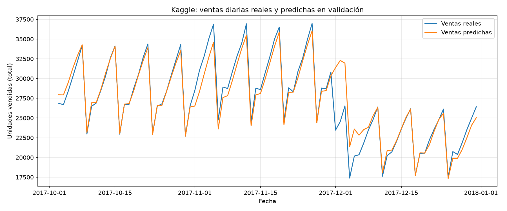
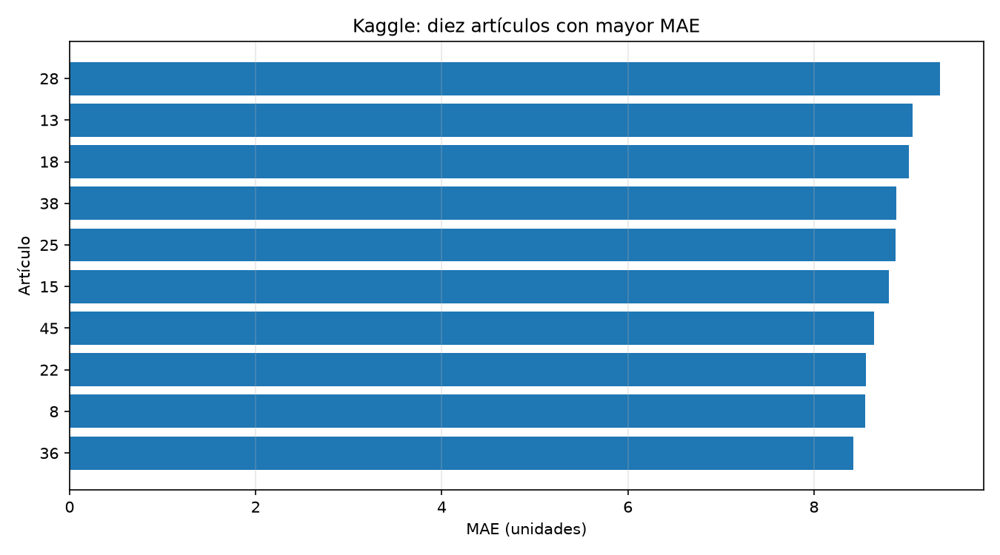

# Pronóstico de demanda diaria: metodología y resultados

**Proyecto académico de Machine Learning — datos externos de Kaggle**

## Resumen

Se compararon una referencia semanal, regresión lineal y Random Forest para estimar unidades vendidas por tienda y artículo. La evaluación cronológica usó tres bloques de 90 días de 2017, con un protocolo diario y otro recursivo. En la prueba recursiva, Random Forest alcanzó el menor error promedio (MAE 8.0865; RMSE 10.5055), pero la regresión lineal fue mejor en uno de los tres bloques. Todos los resultados corresponden exclusivamente a Kaggle; no describen ni predicen las ventas de Kapaq.

## Propósito y alcance

Se desarrolló un experimento de aprendizaje supervisado para estimar las unidades vendidas por tienda, artículo y día. Se utilizó el dataset externo de Kaggle **Store Item Demand Forecasting**. Sus resultados permiten estudiar y comparar métodos de regresión, pero no representan las ventas reales del Minimarket Kapaq.

## Datos

El archivo `train.csv` contiene 913 000 registros entre el 1 de enero de 2013 y el 31 de diciembre de 2017, correspondientes a 10 tiendas y 50 artículos. En la revisión inicial no se encontraron valores vacíos ni registros duplicados por fecha, tienda y artículo. La variable objetivo es `sales`, unidades vendidas.

El conjunto `test.csv` contiene 45 000 combinaciones futuras sin ventas observadas. Por tanto, se pueden producir predicciones para esas filas, pero no calcular su MAE o RMSE sin disponer de las respuestas reales.

## Preparación y variables

Se construyeron variables de calendario (`day_index`, día de la semana y mes) y de historial de ventas por tienda y artículo:

- `lag_7`: unidades vendidas siete días antes.
- `lag_14`: unidades vendidas catorce días antes.
- `media_7_dias` y `media_28_dias`: promedios de ventas anteriores.

Los promedios usan `shift(1)`, de modo que excluyen las ventas de la fecha que se quiere predecir. Las primeras observaciones sin historial suficiente se excluyeron del entrenamiento y la evaluación.

## Métodos comparados

1. **Referencia semanal:** utiliza como predicción las ventas del mismo artículo y tienda siete días antes.
2. **Regresión lineal:** aprende una relación lineal entre las variables disponibles y `sales`.
3. **Random Forest:** combina árboles de decisión y promedia sus predicciones. La configuración probada utilizó 20 árboles, profundidad máxima 12, mínimo de 10 observaciones por hoja, muestreo de 10 % de las filas por árbol (`max_samples=0.10`) y semilla 42.

Los identificadores de tienda y artículo se trataron como categorías mediante codificación *one-hot*, no como magnitudes numéricas.

## Protocolo de evaluación

La separación respeta el orden temporal. Se evaluaron tres bloques consecutivos de 90 días —del 6 de abril al 4 de julio, del 5 de julio al 2 de octubre y del 3 de octubre al 31 de diciembre de 2017—. Para cada bloque, el entrenamiento utilizó fechas anteriores al inicio de la validación.

Se aplicaron dos protocolos:

1. **Predicción diaria con historial observado:** en cada fecha se conocen las ventas ocurridas hasta el día anterior. Es útil para un sistema que emite un pronóstico cada día y recibe ventas nuevas.
2. **Predicción recursiva de 90 días:** al comenzar cada bloque solo se usan ventas anteriores al bloque. Las ventas pronosticadas se agregan al historial para calcular el día siguiente. Este protocolo se aproxima mejor a generar un horizonte futuro sin observar sus ventas.

## Métricas y resultados

El **MAE** (error absoluto medio) es el promedio de las diferencias absolutas entre venta real y predicción; se expresa en unidades por registro (tienda, artículo y día). El **RMSE** es la raíz del promedio de errores cuadrados, también en unidades, y penaliza más los errores grandes. En ambos casos, menor valor indica menor error en los datos evaluados. Las cifras de resumen son el promedio de las métricas de los tres bloques, de igual duración.

| Método | MAE promedio (3 bloques) | RMSE promedio (3 bloques) |
|---|---:|---:|
| Referencia semanal | 9.1883 | 12.0233 |
| Regresión lineal | 7.2411 | 9.4621 |
| Random Forest | **6.7248** | **8.7661** |

En los tres bloques, Random Forest obtuvo menor MAE y RMSE que los otros dos métodos. En el bloque final (3 de octubre a 31 de diciembre de 2017), sus métricas fueron MAE **6.5308** y RMSE **8.6227**. Esto lo identifica como el candidato de menor error en esa evaluación diaria; no demuestra rendimiento en las ventas reales de Kapaq.

### Evaluación recursiva de 90 días

En la prueba recursiva, cada método usa sus propias predicciones como historial durante cada período de validación. El promedio en los tres bloques fue:

| Método recursivo | MAE promedio | RMSE promedio |
|---|---:|---:|
| Referencia semanal recursiva | 11.7130 | 15.4075 |
| Regresión lineal recursiva | 8.8747 | 11.7129 |
| Random Forest recursivo | **8.0865** | **10.5055** |

Random Forest obtuvo el menor error promedio, pero no ganó en todos los bloques: en el segundo bloque la regresión lineal fue mejor (MAE 8.4953 frente a 9.5382). Random Forest sí superó a la referencia semanal en los tres bloques. Sus errores son mayores que en la evaluación diaria con historial observado, lo cual es esperable porque en el pronóstico de varios días se usan predicciones anteriores en vez de ventas reales. Esta evaluación ofrece una estimación más pertinente para un horizonte futuro de 90 días.

| Bloque | Método | MAE | RMSE |
|---|---|---:|---:|
| 2017-04-06 a 2017-07-04 | Referencia semanal | 11.8985 | 15.6304 |
|  | Regresión lineal | 9.6319 | 13.1665 |
|  | Random Forest | 7.3885 | 9.9257 |
| 2017-07-05 a 2017-10-02 | Referencia semanal | 11.5917 | 15.1791 |
|  | Regresión lineal | **8.4953** | **11.0624** |
|  | Random Forest | 9.5382 | 12.0678 |
| 2017-10-03 a 2017-12-31 | Referencia semanal | 11.6487 | 15.4132 |
|  | Regresión lineal | 8.4968 | 10.9097 |
|  | Random Forest | **7.3329** | **9.5230** |

## Análisis adicional

En el análisis de importancia de variables del Random Forest, `lag_7` obtuvo 0.5273 y `media_7_dias` obtuvo 0.3891. Juntas suman 0.9164 de la importancia reportada por el modelo. Esto indica que el modelo se apoyó principalmente en el historial reciente dentro de este experimento. La importancia no demuestra causalidad y puede repartirse entre variables relacionadas.

Los cinco artículos con mayor MAE en el bloque final fueron los identificadores Kaggle 28, 13, 18, 38 y 25. Estos identificadores no corresponden necesariamente a productos de Kapaq.

### Visualizaciones

El primer gráfico muestra las ventas agregadas reales y predichas durante la evaluación diaria del período final; el segundo destaca artículos con mayor MAE en ese período. Son visualizaciones del conjunto de Kaggle, no del minimarket.

## Predicciones del conjunto `test.csv`

Se generaron 45 000 predicciones en `resultados/predicciones_kaggle.csv`, con las columnas `id` y `sales`, verificando los identificadores contra `sample_submission.csv`. El rango generado fue de 9.43 a 125.53 unidades. Como no se conocen las ventas reales de `test.csv`, este rango y el formato correcto no constituyen una evaluación de precisión.

## Integración demostrativa en la web

Se añadió al panel administrativo de Kapaq una pantalla separada, **Pronóstico ML (demo)**. El script `src/pronostico/preparar_demo_web.py` relaciona las predicciones existentes con `test.csv` por el ID de Kaggle y crea un JSON estático para el frontend. La pantalla permite filtrar tienda, artículo y fechas, y visualizar las unidades estimadas. No consulta ni modifica MySQL, no actualiza stock, y no mapea tiendas/artículos Kaggle a los productos de Kapaq. Es una integración demostrativa de las salidas del modelo, no una herramienta de decisión real ni un servicio de inferencia en línea.

Para generar el archivo que consume la pantalla, primero debe existir `resultados/predicciones_kaggle.csv`; luego se ejecuta `venv/bin/python proyecto/src/pronostico/preparar_demo_web.py` desde la raíz del repositorio MachineLearning. El archivo se crea en `Proyecto-Minimarket/frontend/src/assets/data/pronosticos-kaggle.json`. Esta entrega reproduce las predicciones del período de `test.csv`; no permite solicitar fechas arbitrarias ni volver a entrenar desde la página.

## Limitaciones y siguientes pasos

- El dataset es externo y no representa necesariamente la operación, catálogo o clientela de Kapaq.
- Las tiendas y artículos de Kaggle no tienen una correspondencia establecida con los identificadores del minimarket.
- En una predicción recursiva de varios días, los errores pueden acumularse al usar predicciones previas como historial.
- El backtest recursivo se realizó con tres períodos de Kaggle; su desempeño no garantiza los mismos errores en otras fechas ni en Kapaq.
- Para desarrollar y evaluar un pronóstico real de Kapaq se necesita reunir un historial suficiente de ventas reales por producto y fecha, y validar el modelo cronológicamente con esos datos.
- Cualquier demostración web basada en este dataset debe identificarse claramente como una demostración con datos externos, no como recomendación real de inventario.
- La pantalla web muestra predicciones precomputadas para el período de `test.csv`; no es un endpoint de inferencia en línea ni una conexión con las ventas reales de Kapaq.

## Conclusión

En estos experimentos, los tres métodos de regresión mejoraron la referencia semanal en promedio en la evaluación recursiva. Random Forest fue el candidato con menor MAE y RMSE promedio, pero la variación entre bloques —incluida la ventaja de regresión lineal en el bloque 2— aconseja no afirmar que un único algoritmo sea siempre superior. La evaluación recursiva resulta más representativa de un horizonte de 90 días que la evaluación diaria con ventas recientes observadas, aunque sigue siendo un backtest sobre una única serie de datos públicos. Para afirmar utilidad en Kapaq se requiere recolectar ventas reales suficientes y repetir una validación temporal en ese contexto.

## Fuentes

- Kaggle. *Store Item Demand Forecasting Challenge* (dataset y descripción del desafío). https://www.kaggle.com/competitions/demand-forecasting-kernels-only
- Scikit-learn. *LinearRegression*. https://scikit-learn.org/stable/modules/generated/sklearn.linear_model.LinearRegression.html
- Scikit-learn. *RandomForestRegressor*. https://scikit-learn.org/stable/modules/generated/sklearn.ensemble.RandomForestRegressor.html
- Scikit-learn. *Mean absolute error* y *Mean squared error*. https://scikit-learn.org/stable/modules/model_evaluation.html

Este documento resume resultados observados en las ejecuciones locales; debe actualizarse si cambian los datos, variables, configuración o protocolo de evaluación.
